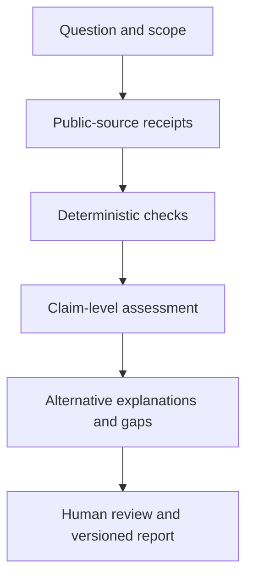

# RECEIPTS

**Follow the evidence. Keep the uncertainty.**

A public-evidence audit harness for tracing sources, checking metadata, following
funding, and testing whether AI conclusions stay within the evidence.

RECEIPTS makes the distinction between a discovered fact and a tempting inference
visible. An archived account ID can establish account continuity without proving
who controlled it. A grant can establish an institutional funding relationship
without establishing who financed a particular announcement. A failed search can
leave a claim unresolved without disproving it.

This is **v0.1.0, a research prototype**. It includes deterministic metadata tools,
a documented audit method, a constrained model prompt, and a paired evaluation
runner. It does not autonomously crawl the web, authenticate a source, identify
people, or certify that a claim is true. Researchers acquire and check public
sources before the model receives a bounded evidence packet.

## Start locally

Python 3.10 or later; the runtime and tests use only the standard library.
Run from the repository root:

```bash
export PYTHONPATH=src
python -m unittest discover -s tests -v
python -m receipts snowflake 1273816504776982529
python -m receipts utc '2026-09-01T00:30:00+09:30'
python -m receipts style examples/posts.json
python -m receipts funding examples/funding.json --payer donor-d --payee person-p
python -m receipts.runner --dry-run --output artifacts/prepared
```

The dry run prepares **32 requests: 16 cases × two prompts**. It does not contact
a model or generate performance scores. Use a fresh output directory for every
experiment; existing results are never overwritten.

## Run a model through GitHub Actions

1. Add an `OPENAI_API_KEY` repository secret in **Settings → Secrets and variables
   → Actions**. Use the provider's project spending controls; never commit or paste
   a key into an issue, source file, or workflow input.
2. Open **Actions → Model evaluation → Run workflow**.
3. Choose a model ID and 4, 8, or 16 cases. The default is the documented snapshot
   `gpt-5.4-mini-2026-03-17`; access depends on the API project.
4. Download the run artifact and inspect `manifest.json`, `results.jsonl`,
   `summary.json`, and `summary.md`, including the model's actual rationales.

An initial commit containing `[receipts-eval]` also requests this experiment.
Ordinary pushes run offline checks without inference. Model evaluation never runs
on pull requests. Workflow actions are pinned to retrieved commit SHAs, credentials
are not persisted by checkout, and the model has no tools or repository access.

Locally, with the key already in your environment:

```bash
PYTHONPATH=src python -m receipts.runner \
  --model gpt-5.4-mini-2026-03-17 --cases 16 \
  --output artifacts/experiment-001
```

Each case receives one independent baseline call and one RECEIPTS call. Requests
use the same evidence, output schema, model, and output-token limit. The order is
shuffled reproducibly; this does not make model outputs deterministic. There are
no retries, and the runner stops on an API error. The default run has at most 32
calls and 1,200 output tokens per call; input tokens are also billable. This is a
call/token bound, not a guaranteed currency budget.

A missing key produces `blocked_missing_api_key` and zero inference calls.
An API error, refusal, incomplete response, or malformed answer cannot silently
become a successful score. A workflow completing successfully means the experiment
ran; it does **not** mean the model performed well or that the prompt helped.

The separate **Compare GPT-4o and GPT-4.1** workflow runs the same frozen suite on
`gpt-4o-2024-11-20` and `gpt-4.1-2025-04-14`: 64 calls total, with separate artifacts.
Run it manually or explicitly request it with `[receipts-compare]` in a main-branch
commit message. It never runs on pull requests or ordinary unmarked pushes.
These snapshots are deprecated with a documented shutdown date of 14 January
2027; availability and project access should be checked before a later rerun.

## What the first experiment measures

**First completed run:** both prompts scored 15/16 on the frozen development
labels; this run showed no verdict-accuracy advantage for RECEIPTS. A funding
case exposed unsupported contradiction, and post-run inspection found an
ambiguity in another case's wording. All 32 responses and the unchanged scores
are preserved in the [first experiment and review](experiments/2026-10-30-gpt-5.4-mini/REVIEW.md).
Estimated API cost was USD 0.039696. These are preliminary development results.

The [requested GPT-4o/GPT-4.1 follow-up](experiments/2026-10-30-gpt4-comparison/REVIEW.md)
used unchanged inputs and scoring:

| Model | Baseline | RECEIPTS |
|---|---:|---:|
| GPT-5.4 Mini | 15/16 | 15/16 |
| GPT-4o | 16/16 | 16/16 |
| GPT-4.1 | 11/16 | 13/16 |

GPT-4.1's strict-score gain comprises one corrected uncertainty judgment and one
corrected claim ID. Two of its other scored mismatches involve ambiguous
evidentiary-sufficiency wording. This small, single-run development suite does not
establish general model rankings or reliable prompt improvement. All 96 responses
are preserved; estimated total API cost was USD 0.231665.

The 16 original synthetic development cases cover account continuity, recycled
handles, human attribution, small writing samples, direct versus indirect funding,
donor direction, incomplete searches, copied reporting, UTC dates, archive capture
times, offensive content attribution, authenticated authorship acknowledgments,
earlier AI statements, source-embedded prompt injection, and policy chronology.

There are four supported claims, four contradicted claims, and eight unresolved
claims. Always abstaining gets only 8/16 verdicts correct. Separate metrics expose
unsupported support and unnecessary abstention. Citation-ID presence and required
limitation codes are also checked; **these checks do not establish that prose is
faithful to the evidence**. A human must review the rationale and source relevance.

The gold labels are never included in model requests. They are visible in this
open repository, so these are development tests, not a secret or independently
held-out benchmark. The author who built the prompt also wrote the cases. No
general capability or performance improvement follows from passing this suite.

## Audit workflow



Read [the audit method](docs/METHOD.md), [evaluation design](docs/EVALUATION.md),
and [source and rights boundaries](docs/BOUNDARIES.md). The public-source acquisition
stage and final report review are researcher tasks in this release. The automated
part is deliberately limited to metadata operations and packet-based inference.

## Origin and license

The method grew from Trent Slade's public-evidence audit:

Slade, T. (2026). *Jacob Coxon's September 2026 resignation: a public-evidence audit
of preparation, funding context, media circulation, and policy response*
(Version 1.1.0). Zenodo. https://doi.org/10.5281/zenodo.23759846

That report motivates the method; it is not a ground-truth authorship dataset.
The synthetic cases use fictional entities and do not restate allegations about
real people. The original report's conclusion remains bounded by its evidence and
cutoffs. No missing connection is converted here into proof of universal absence.

Original code, prompts, documentation, and synthetic fixtures in this repository
are licensed under [Apache-2.0](LICENSE). The published audit retains its existing
CC BY 4.0 license. Third-party sources retain their own rights. See [NOTICE](NOTICE).

Created by Trent Slade / QSOL-IMC with AI-assisted implementation. The methodology
is provider-neutral; this initial executable inference adapter uses OpenAI's
Responses API. See [technical references](docs/REFERENCES.md).
